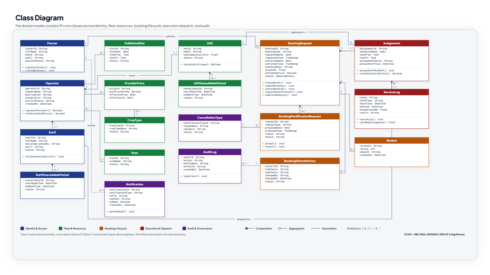
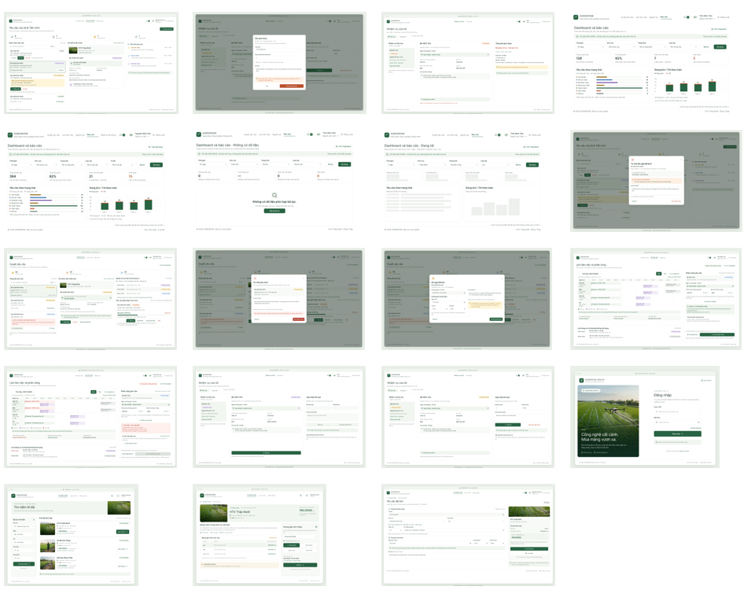

# AgriDrone — UAV Service Booking & Dispatch Support System

**Information Systems Analysis & Design Project | FPT University**

AgriDrone is a centralized web platform connecting farmers with professional agricultural drone spraying teams in the Mekong Delta. This repository serves as the complete Business Analysis and System Design portfolio covering requirements engineering, process modeling, database schema design, and UI wireframing.

---

## 1. Problem & Solution Overview

- **Business Problem:** Agricultural spraying still relies heavily on manual labor and fragmented word-of-mouth intermediaries, creating health risks from chemical exposure, scheduling conflicts, and lack of transparent pricing or job tracking.
- **Proposed Solution:** A web-based booking and dispatch support platform enabling farmers to discover nearby certified UAV teams, submit spraying requests, track execution progress, and manage fleet scheduling without double-booking.

---

## 2. System Actors & Role Matrix

| Actor | Core Responsibilities |
| :--- | :--- |
| **Customer / Farmer** | Search drone teams by region, request spraying quotes, confirm bookings, track job status, and submit service reviews. |
| **Operator / Fleet Manager** | Review incoming requests, provide quotes, manage UAV fleet and pilot availability, and dispatch flight orders. |
| **Field Staff / Pilot** | Receive assigned dispatch orders, perform on-site spraying, and log actual execution status and chemical usage. |
| **System Admin** | Verify and approve drone service providers, moderate user accounts, and monitor platform-wide operational reports. |

---

## 3. Project Deliverables

All formal analysis and design documents are located in the [`docs/`](./docs/) directory:

| Phase | Deliverable | Scope & Contents |
| :--- | :--- | :--- |
| **D1** | [`Group 2 - D1 - Proposal.docx`](./docs/Group%202%20-%20D1%20-%20Proposal.docx) | Business context, problem statement, feasibility study, and project scope. |
| **D2** | [`Group 2 - D2 - SRS.docx`](./docs/Group%202%20-%20D2%20-%20SRS.docx) | Software Requirements Specification: Functional Requirements, Non-Functional Requirements, and Use Case specifications. |
| **D3** | [`Group2 - D3 - System Modeling Package.pdf`](./docs/Group2%20-%20D3%20-%20System%20Modeling%20Package.pdf) | Use Case diagrams, Activity diagrams, Sequence diagrams, and Domain Class Model. |
| **D4** | [`Group 2 - D4 - System Design.pdf`](./docs/Group%202%20-%20D4%20-%20System%20Design.pdf) | 3-Layer modular architecture, REST API specifications, physical PostgreSQL schema, JWT/RBAC security, and UI design. |

---

## 4. System & Database Modeling

### Entity-Relationship Diagram (ERD)

### Domain Class Diagram

---

## 5. UI Wireframes & Mockups

Designed in Figma across core customer, operator, pilot, and admin workflows (full screens available in [`ui-mockups/`](./ui-mockups/)):

---

## 6. Target Architecture Summary

| Layer | Technology / Design Choice |
| :--- | :--- |
| **Presentation** | React SPA (UI-01 to UI-10 responsive workflows) |
| **Application** | 3-Layer Modular Monolith, REST APIs, JWT Authentication & RBAC |
| **Data** | PostgreSQL with Flyway migrations and UAV slot conflict-prevention constraints |

---

## 7. Team Contributors (Group 2)

- **Nguyễn Thị Kiều Duyên** — Team Leader
- **Nguyễn Cao Quốc Khánh** — Business Analysis, System Modeling & UI Design
- **Trương Khánh Ngân** — Requirements & Documentation
- **Trần Nho Toàn** — System Modeling & Design
