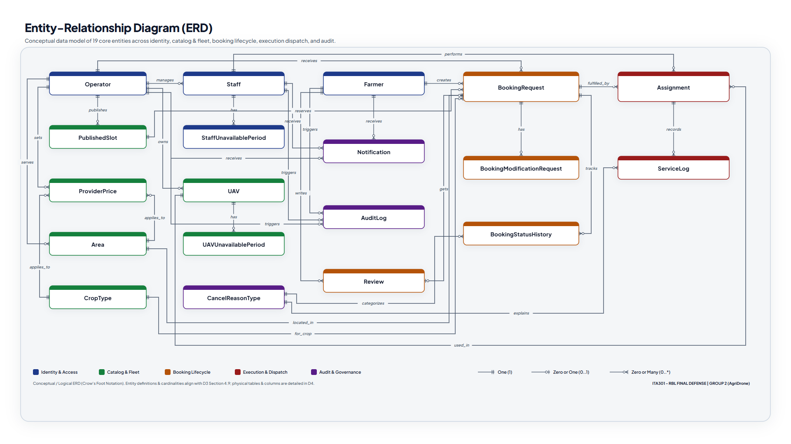

# AgriDrone — Hệ Thống Đặt Lịch & Điều Phối Dịch Vụ UAV Nông Nghiệp

**Đồ án Phân tích & Thiết kế Hệ thống Thông tin**

AgriDrone là nền tảng web tập trung kết nối hộ nông dân với các đội bay UAV chuyên nghiệp tại khu vực Đồng bằng sông Cửu Long. Kho lưu trữ này tổng hợp trọn bộ hồ sơ Phân tích Nghiệp vụ và Thiết kế Hệ thống gồm đặc tả yêu cầu, mô hình hóa quy trình, thiết kế cơ sở dữ liệu và giao diện mẫu.

---

## 1. Bối cảnh & Giải pháp

- **Bài toán thực tế:** Việc thuê dịch vụ phun thuốc bằng máy bay không người lái hiện vẫn diễn ra qua trung gian truyền miệng, thiếu minh bạch về giá, khó tìm đội bay gần khu vực canh tác và dễ xảy ra xung đột lịch trình.
- **Giải pháp hệ thống:** Xây dựng nền tảng đặt lịch và điều phối tập trung cho phép nông dân tìm kiếm đội bay theo khu vực, gửi yêu cầu báo giá, theo dõi tiến độ thực hiện và hỗ trợ đội bay quản lý phân công phi công không bị trùng lịch.

---

## 2. Phân quyền & Các tác nhân chính

| Vai trò | Trách nhiệm nghiệp vụ chính |
| :--- | :--- |
| **Nông dân** | Tìm kiếm đội bay theo địa bàn, gửi yêu cầu đặt lịch phun thuốc, xác nhận báo giá, theo dõi tiến độ và đánh giá dịch vụ. |
| **Điều phối viên đội bay** | Tiếp nhận yêu cầu, báo giá dịch vụ, quản lý lịch bay, phân công phi công và thiết bị UAV phù hợp. |
| **Nhân viên bay / Phi công** | Tiếp nhận lệnh điều phối được giao, thực hiện phun thuốc tại thực địa và cập nhật trạng thái hoàn thành. |
| **Quản trị viên** | Phê duyệt hồ sơ tổ đội bay tham gia nền tảng, quản lý tài khoản người dùng và theo dõi báo cáo vận hành. |

---

## 3. Bộ tài liệu Phân tích & Thiết kế

Toàn bộ hồ sơ chuẩn từ giai đoạn đề xuất đến thiết kế chi tiết nằm trong thư mục [`docs/`](./docs/):

| Giai đoạn | Tài liệu | Nội dung trọng tâm |
| :--- | :--- | :--- |
| **D1** | [`Group 2 - D1 - Proposal.docx`](./docs/Group%202%20-%20D1%20-%20Proposal.docx) | Bối cảnh nghiệp vụ, phân tích vấn đề, đánh giá tính khả thi và phạm vi hệ thống. |
| **D2** | [`Group 2 - D2 - SRS.docx`](./docs/Group%202%20-%20D2%20-%20SRS.docx) | Đặc tả yêu cầu phần mềm: Yêu cầu chức năng, phi chức năng và đặc tả Use Case chi tiết. |
| **D3** | [`Group2 - D3 - System Modeling Package.pdf`](./docs/Group2%20-%20D3%20-%20System%20Modeling%20Package.pdf) | Hệ thống sơ đồ Use Case, Activity Diagram, Sequence Diagram và Domain Class Model. |
| **D4** | [`Group 2 - D4 - System Design.pdf`](./docs/Group%202%20-%20D4%20-%20System%20Design.pdf) | Kiến trúc phân tầng 3 lớp, thiết kế API REST, lược đồ vật lý PostgreSQL, bảo mật RBAC và thiết kế giao diện. |

---

## 4. Mô hình hóa Hệ thống & Cơ sở dữ liệu

### Sơ đồ Thực thể Liên kết (ERD)

### Sơ đồ Lớp miền (Domain Class Diagram)

---

## 5. Thiết kế Giao diện Mẫu (Figma)

Giao diện được thiết kế đồng bộ cho cả 4 vai trò người dùng (xem đầy đủ các màn hình trong [`ui-mockups/`](./ui-mockups/)):

---

## 6. Kiến trúc Đề xuất

| Tầng kiến trúc | Công nghệ & Giải pháp thiết kế |
| :--- | :--- |
| **Presentation** | React SPA cho luồng thao tác đặt lịch, điều phối và theo dõi |
| **Application** | Kiến trúc Modular 3 lớp, REST API, xác thực JWT và phân quyền RBAC |
| **Data** | PostgreSQL kết hợp ràng buộc chống trùng lịch điều phối UAV |

---

## 7. Thành viên thực hiện (Nhóm 2)

- **Nguyễn Thị Kiều Duyên** — Nhóm trưởng
- **Nguyễn Cao Quốc Khánh** — Phân tích nghiệp vụ, Mô hình hóa hệ thống & Thiết kế giao diện
- **Trương Khánh Ngân** — Đặc tả yêu cầu & Tài liệu
- **Trần Nho Toàn** — Mô hình hóa & Thiết kế hệ thống
